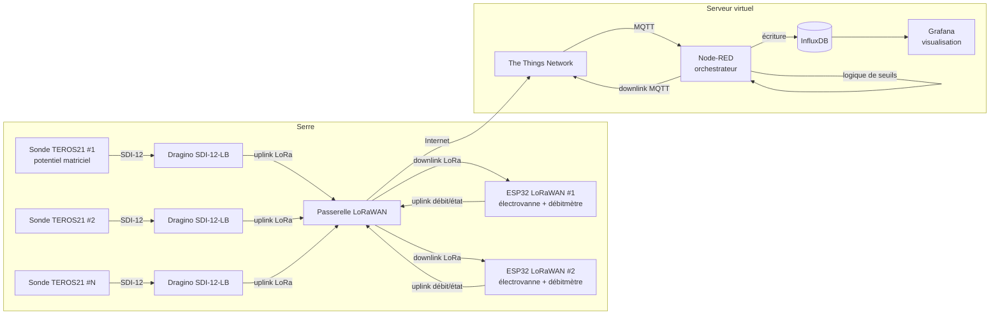

# 🌱 Irrigation de Précision LoRaWAN — Serre

Système d'irrigation de précision piloté par le potentiel matriciel du sol, inspiré du projet [Makerfabs IoT Irrigation System](https://github.com/Makerfabs/Project_IoT-Irrigation-System), adapté à une architecture LoRaWAN professionnelle.

## 📐 Architecture



## 🎯 Principe de fonctionnement

1. Chaque **sonde TEROS21** (METER Group) mesure le potentiel matriciel (kPa) et la température du sol.
2. Un convertisseur **Dragino SDI-12 → LoRaWAN** transmet les mesures via la passerelle LoRa de la serre vers **The Things Network (TTN)**.
3. **Node-RED** (orchestrateur sur serveur virtuel) reçoit les données par MQTT, les stocke dans **InfluxDB** et applique la logique d'irrigation :
   - potentiel matriciel < seuil sec → **ouverture** de l'électrovanne associée (downlink LoRaWAN)
   - potentiel matriciel > seuil humide OU volume max atteint → **fermeture**
4. Chaque **ESP32 LoRaWAN** pilote une électrovanne (1 vanne par sonde = irrigation zonale de précision) et compte les impulsions d'un **débitmètre** pour connaître l'apport d'eau exact.
5. **Grafana** affiche tensiométrie, volumes d'eau, états des vannes et alertes.

## 🔩 Matériel

| Élément | Référence | Rôle |
|---|---|---|
| Sonde tensiométrique | METER TEROS 21 | Potentiel matriciel + T° sol (SDI-12) |
| Sonde capacitive (complément) | DFRobot Gravity SEN0308 V2.0 | Indice d'humidité relatif / θ après calibration (analogique 0–3 V) — sur CR1000 (`1H`) ou Arduino Nano ESP32 (`A0`) |
| Convertisseur | Dragino SDI-12-LB / SDI-12-LS | SDI-12 → LoRaWAN, alimenté batterie |
| Passerelle | Passerelle LoRaWAN 868 MHz (serre) | Uplink/downlink vers TTN |
| Contrôleur vanne | ESP32 + module LoRaWAN (RFM95/SX1276) | Pilotage électrovanne + comptage débit |
| Électrovanne | 12/24 V (1 par sonde/zone) | Irrigation zonale |
| Débitmètre | À impulsions (ex. YF-S201, 1–30 L/min) | Mesure de l'apport d'eau |
| Serveur | VPS (Docker) | Node-RED + InfluxDB + Grafana |

## 📂 Structure du dépôt

```
firmware/esp32_valve_controller/   # Firmware PlatformIO ESP32 (vanne + débitmètre + LoRaWAN)
firmware/esp32_nano_sen0308/       # [Pré-manip] Firmware Nano ESP32 : SEN0308 (série CSV + calibration, option LoRaWAN)
campbell/                          # [Pré-manip] Programmes CR1000 / CR800 : TEROS 22 seule, ou TEROS 22 + SEN0308
balance/                           # [Pré-manip] Collecteur balance Ohaus DP15/M : interfaces PC (Windows) et Mac
tools/calib_sen0308.py             # [Pré-manip] Enregistrement série + ajustement gravimétrique SEN0308
docs/calibration_sen0308.md        # [Pré-manip] Protocole de calibration SEN0308 (3 niveaux)
DIAGNOSTIC.md                      # [Pré-manip] Diagnostic liaison série balance sur macOS
ttn/                               # Décodeurs de payload TTN (TEROS21, contrôleur vanne, SEN0308)
server/docker-compose.yml          # Stack Node-RED + InfluxDB + Grafana
server/nodered/                    # Flow d'orchestration (seuils, downlinks)
grafana/                           # Dashboards (sonde kPa, température, poids balance)
docs/images/                       # Photos et schémas du montage
```

## 🔬 Pré-manips (banc de laboratoire, avant déploiement LoRaWAN)

Avant l'installation en serre, les capteurs sont caractérisés sur un **banc filaire** (pas de LoRaWAN) : un pot sur balance, une TEROS 21/22 sur datalogger Campbell, et la sonde capacitive DFRobot SEN0308 en comparaison. Le but est d'obtenir la relation **poids (évapotranspiration) ↔ potentiel matriciel ↔ indice SEN0308** pour chaque substrat et fixer les seuils d'irrigation. Tout ce qui est marqué *[Pré-manip]* relève de cette phase et n'est pas requis pour le système final.

### Balance Ohaus DP15/M — interfaces PC et Mac (`balance/`)

La balance est lue en RS-232 (protocole SICS, commande `S`, 9600 8N1) via un adaptateur USB-série.

| Plateforme | Fichier | Fonctionnement |
|---|---|---|
| **Windows (PC)** | [balance/balance_gui.py](balance/balance_gui.py) → exe `BalanceCollecteur.exe` (PyInstaller, non versionné) | Fenêtre Marche/Arrêt : détection automatique du port USB (COM3 par défaut), lecture toutes les 5 s, CSV incrémental dans `data balance/`, **envoi vers InfluxDB local** (bucket `sondes`), mise en veille du PC bloquée pendant la collecte |
| **macOS** | [balance/balance_gui_macos.py](balance/balance_gui_macos.py), [balance/install_mac.sh](balance/install_mac.sh), [balance/build_macos.sh](balance/build_macos.sh) | Même interface, **CSV local uniquement** ; indicateurs d'état séparés (port détecté / port ouvert / balance connectée) ; `install_mac.sh` installe Python 3.12 + Tk 8.6 et crée l'app `~/BalanceCollecteur` |
| **Ligne de commande** | [balance/collect_balance.py](balance/collect_balance.py) | `python collect_balance.py --port COM3 --interval 5 [--no-influx]` |
| **Diagnostic** | [balance/diagnose_serial.py](balance/diagnose_serial.py), [balance/diagnose_serial_macos.py](balance/diagnose_serial_macos.py), [DIAGNOSTIC.md](DIAGNOSTIC.md) | Teste adaptateur, port et réponse de la balance étape par étape |

Parseur SICS testé dans [tests/test_balance_parser.py](tests/test_balance_parser.py) (CI GitHub Actions). Dashboard Grafana du poids : [grafana/dashboards/balance_poids.json](grafana/dashboards/balance_poids.json).

### Datalogger Campbell (`campbell/`)

| Programme | Cible | Contenu |
|---|---|---|
| [teros22_cr1000.CR1](campbell/teros22_cr1000.CR1) | CR1000 | TEROS 22 seule (SDI-12 sur C3), table 15 min |
| [teros22_sen0308_cr1000.CR1](campbell/teros22_sen0308_cr1000.CR1) | CR1000 | TEROS 22 + SEN0308 (5V / G / 1H), table `MesuresSol` + table `CalibSEN0308` |
| [teros22_sen0308_cr800.CR8](campbell/teros22_sen0308_cr800.CR8) | CR800 | Identique pour CR800 |

La balance est volontairement **hors datalogger** : elle est acquise par le PC/Mac et croisée avec les données Campbell/InfluxDB par horodatage.

## 🧪 [Pré-manip] Sonde DFRobot SEN0308 (en complément de la TEROS)

La SEN0308 fournit un **indice relatif** (0 % = air, 100 % = eau) qui dépend du substrat et de l'alimentation : elle doit être calibrée sur la chaîne de mesure définitive — protocole dans [docs/calibration_sen0308.md](docs/calibration_sen0308.md).

| Option | Câblage | Fichier | Avantage |
|---|---|---|---|
| **A — Campbell CR1000 / CR800** (recommandé) | rouge→`5V`, noir→`G`, jaune→`1H` | [campbell/teros22_sen0308_cr1000.CR1](campbell/teros22_sen0308_cr1000.CR1), [campbell/teros22_sen0308_cr800.CR8](campbell/teros22_sen0308_cr800.CR8) | TEROS et SEN0308 horodatées dans la même table → co-localisation directe (niveau 3) |
| **B — Arduino Nano ESP32** | rouge→`3V3`, noir→`GND`, jaune→`A0` | [firmware/esp32_nano_sen0308/](firmware/esp32_nano_sen0308/) + [tools/calib_sen0308.py](tools/calib_sen0308.py) | Autonome, CSV série + InfluxDB ; variante LoRaWAN (RFM95) avec décodeur [ttn/decoder_sen0308.js](ttn/decoder_sen0308.js) |

Calibration rapide (option B) : `python tools/calib_sen0308.py --port COM5 --ref air` puis `--ref water`, reporter `AIR_MV`/`WATER_MV` dans `config.h`.

## ⚙️ Seuils d'irrigation (exemple)

| Paramètre | Valeur par défaut | Description |
|---|---|---|
| `SEUIL_SEC` | −40 kPa | En dessous → démarrer irrigation |
| `SEUIL_HUMIDE` | −10 kPa | Au-dessus → arrêter irrigation |
| `VOLUME_MAX` | 10 L | Sécurité : volume max par cycle |
| `DUREE_MAX` | 15 min | Sécurité : durée max d'ouverture |

Les seuils sont configurables par zone dans Node-RED (`server/nodered/`).

## 🚀 Mise en route

1. **TTN** : créer une application, enregistrer les Dragino et les ESP32 (OTAA), coller les décodeurs de `ttn/`.
2. **Serveur** : `docker compose up -d` dans `server/`, configurer l'intégration MQTT TTN dans Node-RED.
3. **Firmware** : renseigner les clés OTAA dans `firmware/esp32_valve_controller/src/config.h`, compiler avec PlatformIO, flasher.
4. **Grafana** : importer le dashboard (voir `grafana/`), pointer la datasource InfluxDB.

## 📊 État d'avancement (09/10/2026)

| Étape | État |
|---|---|
| **Pré-manip** — collecteur balance Ohaus : interface Windows (exe) et macOS, CSV + InfluxDB, dashboard Grafana poids | ✅ Opérationnel (PC) ; Mac validé en diagnostic série |
| **Pré-manip** — programmes Campbell CR1000/CR800 TEROS 22 (+ SEN0308) | ✅ Écrits (TEROS seule testée sur CR800) |
| **Pré-manip** — sonde DFRobot SEN0308 : protocole de calibration, firmware Nano ESP32, outil Python | ✅ Écrits — calibration terrain à faire |
| Firmware ESP32 vanne + débitmètre | ✅ Écrit (à flasher/tester) |
| Décodeurs TTN (TEROS21, vanne, SEN0308) | ✅ Écrits |
| Stack Docker Node-RED/InfluxDB/Grafana | ✅ Opérationnelle en local |
| Flux Node-RED « IoT Irrigation Piloté » | ✅ Déployé — dashboard `/ui` : jauge kPa, seuils réglables, mode auto, boutons OUVRIR/FERMER par zone |
| Export du flux | ✅ [server/nodered/flow_iot_irrigation_pilote.json](server/nodered/flow_iot_irrigation_pilote.json) (importable) |
| Application TTN | ⬜ À créer (identifiants MQTT à renseigner dans Node-RED) |
| Enregistrement des devices (Dragino, ESP32) | ⬜ À faire |
| Installation terrain (sondes, vannes, passerelle) | ⬜ À faire |
| Photos du montage | ⬜ À ajouter dans `docs/images/` |


## 📸 Photos

Les photos du montage (sondes, vannes, passerelle, serre) sont dans `docs/images/` — *à compléter avec vos photos de terrain.*

## 📜 Licence

MIT — librement inspiré de [Makerfabs Project_IoT-Irrigation-System](https://github.com/Makerfabs/Project_IoT-Irrigation-System).
